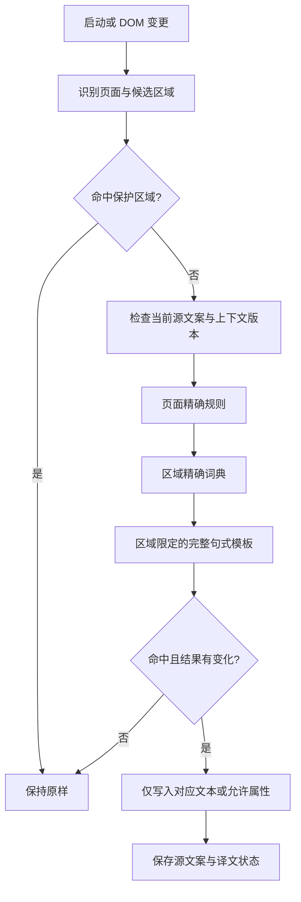

# HLTV 简体中文油猴脚本开发设计方案

研究日期：2026-10-08。项目目录：`D:\develop\Projects\hltv2zh_cn`。

## 1. 结论与产品定位

建议新建模块化的 TypeScript 项目，构建为一个可安装的 `.user.js` 文件。采用“页面适配器 + 分域词典 + 精确匹配 + 增量 DOM 翻译”的方案，将旧版作为词条和场景参考。

第一版定位为 **HLTV 界面汉化**：用户仍在原网站浏览，菜单、筛选项、比赛状态、表头和说明变为简体中文，队名、选手 ID、赛事正式名称和数据保持原样。新闻正文和论坛发言属于自由文本，暂不纳入自动翻译。这样可以先交付一个无需后端、无需翻译 API、可离线执行翻译规则的稳定版本。

本次只交付调研与设计文档，没有修改参考脚本、安装油猴脚本或验证新脚本运行效果。

## 2. 调研依据与验证边界

### 2.1 当前项目

当前目录仅发现 `DiscontinuedScripts/HLTV中文化NEXT-1.7.0.user.js`，没有现成构建配置、测试工程或项目说明；当前目录也不是 Git 仓库。以下目录和工具均为拟建方案。

参考脚本共 1236 行，声明版本 1.7.0、作者 YHFZ、许可证 MIT，匹配 `https://www.hltv.org/*`，使用 `@grant none` 和 `document-end`。文件 SHA-256：

`95A4B1324903D44CA0F898B8FDDB3FD7642CA25922A6F81CE7F0793A82AC223C`

### 2.2 实际研究的网页

| 页面 | 本次证据 | 得出的设计要求 |
|---|---|---|
| [首页](https://www.hltv.org/) | 浏览器页面与 DOM 抽样；网页读取 | 公共导航、新闻标题与元信息、比分、侧栏要分别处理 |
| [比赛列表](https://www.hltv.org/matches) | 浏览器页面与 DOM 抽样；网页读取 | 处理筛选、日历、比赛状态；保留筛选值和队名 |
| [比赛详情样本](https://www.hltv.org/matches/2398979/gamerlegion-vs-bet-m-1win-private-club-season-2-closed-qualifier) | 浏览器页面与 DOM 抽样 | 日期、LIVE、赛制、选禁图是高价值适配点 |
| [赛果列表](https://www.hltv.org/results) | 浏览器 DOM 抽样；网页读取 | 翻译日期分组标题和分页句式，保留比分 |
| [赛事列表](https://www.hltv.org/events) | 浏览器 DOM 抽样；网页读取 | 保留嵌套日期节点，区分赛事名称和赛事状态 |
| [数据总览](https://www.hltv.org/stats) | 网页读取返回内容；浏览器停在 `Just a moment...` | 未取得可用于确认适配器的正常浏览器 DOM |
| 战队、选手、排名、转会、论坛详情、Fantasy、登录弹窗 | 参考脚本与导航入口 | 后续补采样；不声称已完成实页验证 |

证据分为：A＝当前浏览器 DOM；B＝网页工具返回的页面文本；C＝参考脚本；D＝设计建议。B 可能来自抓取或缓存，不等价于当前会话交互成功。以下源码问题属于静态确认，影响程度仍需测试。

### 2.3 当前 DOM 的关键发现

1. 首页主导航使用 `.nav-link`、`.nav-item`。Stats 链接内含 `.dropdown-icon` 和 SVG。只能更新链接中的文字节点，不能给整个链接赋 `textContent`。
2. 首页 `.newsheader` 是分组标题；`.newstext` 是新闻标题；`.newsrecent` 是相对时间。可以翻译栏目和时间，同时保护标题。
3. 首页比分带 `data-livescore-match`、`data-livescore-current-map-score`、`data-livescore-team` 等属性。比分和这些属性应交由网站管理。
4. 比赛列表存在 `.upcoming-headline` 与 `.matches-filter-name-text`。对应 input 同时有 `id`、`name`、`data-filter`、`data-filter-value`；仅汉化标签文字。
5. 比赛详情 `.timeAndEvent` 内分别有 `.time`、`.date`、`.countdown`。它们带 `data-unix`、`data-time-format` 等属性；同一时间戳承担多种显示用途。
6. `.veto-box` 有两类内容：包含换行与直播链接的赛制说明，以及逐行选禁图记录。需要两个适配规则，不能用一个大范围替换处理全部内容。
7. 赛事列表 `.event-status-headline`、`.event-status-upcoming-headline` 分别是进行中和即将开始；日期是多个嵌套 span，不是一个可随意重建的字符串。
8. 赛果日期标题使用 `.standard-headline`，但该类也用于其他模块。必须叠加页面范围和完整句式校验。
9. 不同页面导航的 `data-nav-sub-menu-toggle-target` 值具有不同后缀。不要硬编码这些具体值；优先使用语义 class 和路径。

这些选择器仅代表当日样本，不代表站点对外保证的稳定接口。

## 3. 汉化范围与优先级

| 优先级 | 页面/模块 | 第一阶段内容 | 保护边界 |
|---|---|---|---|
| P0 | 公共导航、搜索、设置 | 菜单、搜索占位符、基础操作文案 | 不修改输入内容、URL、图标、设置值 |
| P0 | 首页 | 栏目标题、相对时间、评论数量、侧栏标签 | 新闻标题/摘要、队名、选手名保持原文 |
| P0 | 比赛列表 | 状态、筛选标签、排序文案、日期标题 | 不改变筛选参数、比赛时间、比分、赔率 |
| P0 | 比赛详情 | 赛制、阶段、状态、阵容标题、选禁图 | 保留队名、链接、比分及直播组件 |
| P0 | 赛果列表 | 分组日期、筛选项、分页信息 | 不修改赛果与数据字段 |
| P1 | 赛事列表/详情 | 状态、奖金标签、赛制、对阵阶段 | 赛事正式名称、金额和名次数据保留 |
| P1 | 战队/选手档案 | 固定栏目、阵容状态、基础数据标签 | 不用人名黑名单决定保护范围 |
| P1 | Stats | 表头、指标解释、筛选器 | 区分每回合/每场、旧版/新版指标 |
| P1 | 排名/VRS/转会 | 标签、排名说明中的固定模板 | 不改积分、顺位、队伍和选手标识 |
| P2 | 论坛/Fantasy/名人堂等 | 固定 UI 外壳 | 自由文本另行定义翻译产品 |
| 暂不覆盖 | `/betting`、广告、外部 iframe | 延续参考脚本的页面排除边界 | 不干预广告、验证页和第三方播放器 |

P0 可形成首个可用版本；P1 分批扩展，不以“全站 100% 汉化”为首版承诺。地图名作为独立设置。首版默认英文；0.1.7 按用户新增要求改为默认全站中文完整词条匹配，并增加独立地图模块，仍可切回英文。正文和实体受保护，不做任意子串替换。统计缩写按各模块当前术语规范处理，中文解释放在已确认用途的提示区域。

新闻全文机翻可列为未来独立扩展：需要另行设计服务商、费用、术语保护、缓存、用户触发与失败回退，不能靠增加通用词典实现。

## 4. 参考脚本评估与迁移取舍

### 4.1 值得继承

- 已归纳导航、赛事阶段、地图、时间和统计等领域词条。
- `ctxRules` 按父元素、选择器、属性和规则表匹配，有上下文意识。
- 区分文本翻译与 placeholder/title 翻译，并使用 TreeWalker 遍历。
- 使用 MutationObserver 接入动态内容，保护了一批新闻、论坛和赛事名区域。
- 日期、BP、转会句式等特殊场景可转为新工程的测试用例。

### 4.2 已确认的源码问题

以下行号对应原始 1.7.0 文件，不意味着已在所有现网页复现。

| 源码位置 | 事实与可能影响 | 新设计 |
|---|---|---|
| 250–255、1080 | 每个候选文本依次执行整组通用正则；词边界不能区分实体与界面词 | 精确词典查表优先；模板仅在指定区域运行 |
| 223–226、1073–1081 | 用有限人名/队名列表保护实体，且在动态规则之后执行 | 先识别实体区域；不翻译实体文本 |
| 234、1030、1084 | WeakSet 只记“处理过”，不记源文案版本 | WeakMap 保存当前源文案、译文、规则及上下文版本 |
| 1232–1235 | 未启用 `characterData` | 覆盖原 Text 节点 `nodeValue` 更新 |
| 1201–1229 | 处理新增节点后，又设置 600ms 的 body 全量遍历 | 使用去重增量队列；移除常态全页重扫 |
| 704、756、878、883、893、901 | 多处重写 `innerHTML` | 不替换网站的容器、事件节点和图标 |
| 1036–1048 | 用父 td 的 `textContent` 替换整个日期范围，会移除 span 和属性 | 分别汉化现有日期节点 |
| 1053、1083 | 匹配前 trim/合并空白，翻译结果直接写回 | 保存前后空白及换行；仅规范化匹配键 |
| 1066 | 含任意中文的节点被直接跳过 | 依据源文案与规则判断，不按中文字符一刀切 |
| 987–988 | `ALL(数字)` 直接返回“全部”，丢弃数量 | 模板保留捕获的数量，如“全部 (45)” |
| 631–633、1041–1048 | 用浏览器本地时区重新生成日期 | 默认翻译站点显示日期，不重新选择时区 |
| 1090–1163、1234 | 属性处理较分散，观察仅包含 title/class | 将可翻译属性和动态属性声明到适配器 |
| 1171–1184 | 异常被吞掉，不提供可定位诊断 | 按规则记录限量错误；开发模式可导出 |

术语也需要重新审核。例如 `AWP KILLS / ROUND` 被译为“场均 AWP 击杀”，应为“每回合 AWP 击杀”；`Average damage per round` 应为“平均每回合伤害”。`REQUIRE ALL PLAYERS` 在筛选器中应表达“必须包含全部所选选手”，不应译为“请求全部选手”；具体取词仍需该控件实页验证。

### 4.3 迁移方式

建立词条迁移表，字段包含原文、旧译、新译、页面、规则类型、证据等级、测试用例和处理状态。将旧词条分为保留、修订、限定上下文、弃用四类。

不要直接导入整张 dictionary 后全局运行。先迁移 P0 的精确词条，再迁移数字模板，最后迁移跨节点场景。原文件保留作为历史参考。复用代码时保留作者及可获得的许可声明；发布前补齐来源说明。

## 5. 技术选型与工程结构

采用 TypeScript、原生 DOM API 和 esbuild，打包为 IIFE 单文件。无需 Vue/React，也不需要后端。构建时内联词典，浏览时不拉取远程词典或执行远程代码。[esbuild 官方文档](https://esbuild.github.io/api/#bundle)支持将模块打包为浏览器产物；这属于选型建议，本次没有安装依赖。

测试建议使用 Vitest + jsdom 验证纯规则和 DOM 行为，再用 Playwright 在本地脱敏页面片段上做浏览器回归。油猴管理器安装与真实站点交互另做人工验收，不能以测试夹具代替。

```text
hltv2zh_cn/
  DiscontinuedScripts/           # 原参考文件
  docs/
    开发设计方案.md
    页面覆盖矩阵.md              # 开发阶段建立
    术语规范.md
    验收记录.md
  src/
    main.ts                      # 启动、页面识别、生命周期
    core/
      types.ts                   # 规则/适配器/状态契约
      engine.ts                  # 规则解析与命中优先级
      walker.ts                  # 子树裁剪与候选节点遍历
      scheduler.ts               # 去重队列与分片
      observer.ts                # DOM 变更到候选任务
      state.ts                   # 原文/译文、幂等与恢复
      guards.ts                  # 内容、实体和编辑区域保护
    adapters/
      common.ts
      home.ts
      matches.ts
      match-detail.ts
      results.ts
      events.ts
      profiles.ts
      stats.ts
      rankings.ts
      transfers.ts
    locales/zh-CN/
      common.ts
      matches.ts
      events.ts
      stats.ts
      maps.ts
    features/
      settings.ts
      menu.ts
      diagnostics.ts
  tests/
    fixtures/                    # 最小化、脱敏 DOM 样本
    unit/
    dom/
    browser/
  scripts/build.mjs
  userscript.meta.json
  package.json
  package-lock.json
  tsconfig.json
  dist/hltv-zh-cn.user.js
```

文件按出现实际需求后建立，避免先生成空模块。开发环境固定 Node LTS 与依赖锁文件；版本在实施时确认，不依赖“最新版”自动漂移。

### 5.1 油猴元数据与运行环境

- `@match https://www.hltv.org/*`，启用 `@noframes`；默认在 `document-end` 启动。
- 使用新名称、namespace 和版本号，不复用原作者的更新地址。
- 推荐通过 `GM_getValue`、`GM_setValue` 保存少量偏好，通过 `GM_registerMenuCommand` 提供入口；权限只声明实际使用的 API。
- 不申请跨域请求权限，不使用 `unsafeWindow`，不在页面里暴露持久化操作接口。
- 默认不改写 history/fetch/XHR。普通页面导航重新启动；若将来确认存在同页路由，再增加相应适配。
- 未识别页面仅运行经过保护的公共导航规则；验证页或不存在正常站点结构时静默不处理。
- 油猴 API 与元数据以 [Tampermonkey 官方文档](https://www.tampermonkey.net/documentation.php) 为准，实施时验证目标管理器；本次未验证沙箱运行。

首版目标环境建议为 Chrome/Edge + Tampermonkey；Firefox、Violentmonkey 作为后续兼容项，不能未经测试写为已支持。

## 6. 翻译引擎设计

### 6.1 规则执行次序



图中后续匹配阶段仅在前一阶段未命中时执行。命中后终止，不让译文继续进入其他词典。保护优先于所有翻译规则，具有歧义的词没有“全站兜底替换”。

精确词典按页面/区域建 Map。匹配键可统一大小写和连续空白，但输出保留原节点前后空白；多行赛制规则应单独保留换行。带计数、日期或实体的句式使用完整锚定模板，禁止无上下文替换 `all`、`map`、`online`、`joins` 等片段。

### 6.2 数据契约示意

```ts
type AttributeName = 'title' | 'placeholder' | 'aria-label' | 'alt';

interface TranslationRule {
  id: string;                     // 如 home.news.comments
  page: string;
  scope: string;                  // 在适配器注册的语义区域
  target: 'text' | AttributeName;
  kind: 'exact' | 'template';
  source: string | RegExp;
  render: string | ((match: RegExpMatchArray) => string);
  priority: number;
  evidence: 'live-dom' | 'legacy' | 'fixture';
}

interface NodeState {
  source: string;
  rendered: string;
  ruleId?: string;
  contextKey: string;             // 页面、区域、规则与设置版本
}
```

实际实现可用判别联合强化类型。构建检查必须阻止重复 ID、同范围冲突词条、模板缺失参数和无效选择器。规则命中多项时按照显式优先级处理，同级歧义视为规则错误。

### 6.3 文本与属性策略

- 普通文案修改 Text.nodeValue；不对站点容器赋 `innerHTML`。
- 遍历器在 SCRIPT、STYLE、TEXTAREA、CODE、PRE、编辑区和内容区根节点直接裁剪子树。
- input 的 placeholder 可翻译；输入 value、name、id、data-filter-value 均不修改。按钮 value 如确有必要，必须有独立白名单与交互回归，首版先不覆盖。
- title、aria-label、alt 只在适配器白名单里处理；队徽、人像等实体图片的 alt/title 保留名字。
- 不修改 href、src、data-unix、data-time-format、排序键或业务数据。
- 既有 tooltip 可能由属性生成、也可能是动态元素；分别处理源属性和浮层文本，实测生成行为。
- SVG 仅在确认的 `<text>` 标签需要时适配；不修改 path、图标字体或 Canvas。

### 6.4 原文、幂等和网站更新

用 WeakMap 保存文本节点状态，属性使用 WeakMap<Element, Map<属性名, 状态>>。每次处理先读取当前值：

1. 当前值等于 `rendered`，上下文和设置版本相同：跳过自己的写入。
2. 当前值不同于 `rendered`：视为网站的新源文案，更新 source 后重新匹配。
3. 值未变化但节点移动到新上下文或设置改变：使用保存的 source 重新判断。
4. 规则没有命中：保留当前源文案，不为强行覆盖而降级到全文替换。

WeakMap 不可遍历，因此“恢复原文”通过一次受控 DOM 遍历查找仍连接且有状态的节点。只有当前值等于该节点最后一次 rendered 才恢复 source；网站已经写入新值时绝不覆盖。恢复时暂停调度，处理完毕再按设置决定是否重新启用。

默认提供“启用/停用并刷新”，保证容易回到网站原始状态；无刷新恢复作为通过上述回归测试后启用的能力。不能仅保存页面首次英文后永久覆盖后续实时更新。

## 7. 动态内容与性能

MutationObserver 开启 `childList + subtree + characterData`，属性监听仅声明 title、placeholder、aria-label、alt 等实际使用项。`class` 和其他业务属性若确需观察，应放在特定模块的局部 observer 中。不同变更类型需要分别开启对应选项，参见 [MDN observe 文档](https://developer.mozilla.org/en-US/docs/Web/API/MutationObserver/observe)。

执行策略：

1. 初次扫描注册的公共区域与当前页面区域；暂未找到区域时保留发现能力。
2. observer 回调只归集任务，避免同步大量遍历或写 DOM。
3. 新增元素入子树队列；Text 变化入文本队列；属性变化入属性队列。
4. 合并父子覆盖的任务，去掉已断开的节点；移入新区域的旧节点重新核对上下文。
5. 用 requestAnimationFrame 分片执行，建议初始每片预算 4–8ms；预算只是待测参数。
6. 队列采用最大等待时间，不能用不断重置的 debounce 让翻译无限延期。
7. 自身写入通过状态比对消除，不依赖长时间 disconnect；不能盲目清空 observer 记录而丢掉站点更新。
8. 大子树用可续跑 TreeWalker，不把整页扫描塞进一次任务。新发现模块才做该模块初始扫描。

不运行周期性 body 扫描。不监听比分属性，不翻译纯数值，跳过统计和广告中的非候选区域。若某规则引发持续往返改写，限流并暂停该规则，保留网站内容，记录诊断事件。

性能验收建议：固定浏览器、视口与页面夹具，对比禁用/启用脚本；记录首次扫描、候选数、命中数、扫描数、队列深度、单批耗时。目标为“单批尽量低于 8ms、无脚本导致的超过 50ms 长任务、前台新增 UI 文案通常 200ms 内汉化”。这些是验收目标，不是本次测量结果。静止页面完成翻译后不应持续产生翻译写入。

## 8. 容易出错的领域规则

### 8.1 时间与日期

汉化默认不更改网站时区。将页面已显示的英文日期转为中文日历表达，例如保留同一年月日与时间。不能把 `data-unix` 一律按浏览器时区重算：用户可能已在 HLTV 选择其他时区。

仅在明确取得站点实际显示时区后，才允许基于时间戳格式化。日期范围两端分别翻译，保留 span 与 data 属性；无年份日期不擅自补年份。倒计时只改单位，不自己运行第二个计时器。

### 8.2 实体与选禁图

区域优先保护战队、选手、赛事、用户名、新闻标题和评论。名称可含普通英文词，`Just Players`、`Online`、`Train` 等不应因为词典命中就改变。

BP 模板仅匹配已确认的逐行 BP 容器。例如 `1. GamerLegion removed Anubis` 可显示为 `1. GamerLegion 禁用 Anubis`。地图中文模式只作用于末尾地图槽位；队名捕获组原样输出。保留原节点和链接，不用 HTML 拼接输出捕获内容。

跨节点转会句子按片段处理，例如 `选手链接 + transfers from + 战队链接 + to + 战队链接`。优先采用不需要移动链接的中文句式；确实需要追加文字时，标记脚本拥有的节点，保证重复处理不重复追加，并支持移除。

### 8.3 统计术语与布局

| 概念 | 建议表达 | 约束 |
|---|---|---|
| Match / Event / Round / Map | 比赛 / 赛事 / 回合 / 地图 | 不混用“场”“局”解释分母 |
| Kills per round | 每回合击杀 | 保留 KPR 缩写 |
| Average damage per round | 平均每回合伤害 | 保留 ADR 缩写 |
| Rating 及版本 | 保留原标签与版本号 | 解释跟随当前原文，不能套旧定义 |
| Ranked / Unranked | 计入排名 / 不计入排名 | 仅用于已确认的排名筛选语义 |
| Benched | 替补 / 转为替补 | 用中性表达 |
| Map 名称 | 0.1.7 默认中文，可选英文 | 全页完整地图名称/缩写匹配，保护实体/正文/输入/筛选值 |

紧凑表头保留缩写，长解释放在提示文本。只给确有问题的区域加命名空间样式，不覆盖全站字体、宽度和行高。测试窄屏、深浅主题、缩放与筛选弹窗，防止中文变长后按钮不可点。

## 9. 用户设置与维护诊断

最小设置：总开关、地图名模式、模块开关、恢复默认。设置放在油猴菜单，必要时再增加一个小型原生设置面板，不建设独立管理后台。

本地配置采用带 schemaVersion 的结构，未知或损坏字段回退默认值。开关变更提高配置版本，触发相关模块受控重译或提示刷新。

开发模式可记录：页面类型、规则 ID、匹配数量、耗时、受影响选择器、异常类别。未翻译文案收集仅限已识别 UI 区域，设长度和条数上限；不采集账号输入、新闻全文或论坛发言，不自动上报。用户主动导出诊断时应可预览。

维护覆盖矩阵记录：路由、模块、状态、词条数、最新实页检查日期、证据等级、已知遗漏。某选择器命中为零只能说明当前样本没有命中，不可直接认定站点改版；结合页面形态与预期 fixture 判断。

## 10. 测试与发布验收

### 10.1 必须具备的回归用例

| 类别 | 验收内容 |
|---|---|
| 规则 | 大小写、NBSP、前后空白、完整句式、不匹配样本；数量/版本/实体不丢失 |
| DOM | 导航 SVG、链接、input 与事件监听仍存在；不替换容器 |
| 动态 | 新增元素、新增 Text、原 Text 改值、属性变更、节点复用与区域移动 |
| 幂等 | 同一 DOM 处理多次不多写、不重复后缀，不形成 observer 循环 |
| 原文恢复 | 网站已经更新的比分/时间/文案不被恢复功能覆盖 |
| 保护 | 新闻、帖子、昵称、队名、输入框、contenteditable、代码区域保持原样 |
| 日期 | 跨月/跨年、无年份范围、站点时区与系统不一致、倒计时继续更新 |
| 属性 | title、placeholder、aria-label 更新正确；实体图片描述不误翻 |
| 交互 | 菜单展开、筛选、日历、分页、表格排序、详情链接及 tooltip 正常 |
| 性能 | 高频比分更新、批量列表插入、长表格、空闲页面均无持续重扫 |
| 布局 | 桌面宽屏、窄屏、深浅主题、125% 缩放；先记录原站表现再比较 |

本地浏览器测试可加载构建产物，但无法证明 GM 沙箱、管理器更新和站点验证流程可用。发布验收必须使用实际 Tampermonkey 安装产物，检查菜单、持久化、刷新和真实页面。

### 10.2 发布门槛

- typecheck、规则校验、单元/DOM 测试和本地浏览器回归通过。
- P0 覆盖矩阵中列出的固定标签用例全部通过；关键误译、数据损坏、交互损坏为零。
- 首页、列表、进行中/未开始/已结束比赛详情有实际安装验收记录。
- P1 未实测页面明确标注，不以“词典已有词条”视作覆盖完成。
- 产物含元数据和正确版本，无开发服务器、远程执行依赖或原作者更新地址。
- README 写明范围、安装方法、已知遗漏与支持环境。避免同时启用新旧两份汉化脚本。
- 保留上一版产物用于回退；更新记录区分新增覆盖、翻译修订和兼容性修复。

## 11. 分阶段开发计划

| 阶段 | 工作与交付物 | 完成条件 |
|---|---|---|
| M0 证据与术语 | 页面覆盖矩阵、最小 DOM fixtures、词条迁移表、术语规范 | 每条 P0 规则可追溯到样本；统计页阻塞明确登记 |
| M1 引擎骨架 | 构建、类型契约、区域保护、精确词典、属性翻译、状态缓存 | 单文件可安装；导航图标不丢；无全局子串替换 |
| M2 动态机制 | observer、去重队列、分片、源文案更新、停用/恢复 | 节点更新、复用、循环和恢复测试通过 |
| M3 首版 P0 | 首页、比赛列表/详情、赛果适配器；GM 菜单和偏好 | 真实 Tampermonkey 验收通过，发布 0.1.0 候选 |
| M4 内容扩展 | 赛事、选手、战队、Stats、排名/VRS、转会逐批接入 | 每批补齐实页证据、术语审核与回归 |
| M5 发布维护 | 文档、版本产物、安装/升级验证、问题模板 | 覆盖范围可追踪，回退产物可用 |

建议按以下任务顺序实施：

1. D01：建立项目说明、覆盖矩阵与术语规范。
2. D02：保存 P0 的脱敏最小 DOM 样本。
3. D03：配置 TypeScript、构建和元数据生成。
4. D04：定义适配器、规则与状态契约。
5. D05：实现区域保护、子树裁剪与精确匹配。
6. D06：实现文本/属性写入和幂等缓存。
7. D07：实现增量观察、调度和有界诊断。
8. D08：接入公共导航和首页适配器。
9. D09：接入比赛列表和赛果适配器。
10. D10：接入比赛详情、BP 和日期模板。
11. D11：实现 GM 菜单、模块开关与配置存储。
12. D12：完成 P0 安装验收与首版说明。
13. D13：逐批迁移 P1，优先赛事与档案页。
14. D14：完成统计语义审核及真实 tooltip 核验。
15. D15：发布检查、更新说明与回退演练。

先完成 D01–D12，再扩大词典覆盖。核心风险是 DOM 和语义边界，因此应先把保护、幂等和动态更新做实，再增加规则数量。

## 12. 尚待验证与来源

尚待验证：统计页及各档案详情的当前 DOM、登录态与匿名态差异、菜单/tooltip 的完整动态路径、移动端布局、油猴管理器沙箱行为、真实站点性能。Cloudflare 验证页未绕过；统计页面在浏览器验证通过后再补取正常样本。

参考来源：

- [本地参考脚本](../DiscontinuedScripts/HLTV中文化NEXT-1.7.0.user.js)：词条、旧规则与源码问题依据。
- [HLTV 首页](https://www.hltv.org/)、[比赛列表](https://www.hltv.org/matches)、[赛果](https://www.hltv.org/results)、[赛事](https://www.hltv.org/events)：站点模块和页面样本。
- [比赛详情样本](https://www.hltv.org/matches/2398979/gamerlegion-vs-bet-m-1win-private-club-season-2-closed-qualifier)：时间、赛制、选禁图 DOM。
- [Tampermonkey 文档](https://www.tampermonkey.net/documentation.php)：后续元数据和 GM API 实施依据。
- [MDN MutationObserver.observe](https://developer.mozilla.org/en-US/docs/Web/API/MutationObserver/observe)：变更监听选项。
- [esbuild API](https://esbuild.github.io/api/#bundle)：模块化源码与单文件分发。

网页和源码分析只能支撑设计；本方案中的架构、目标指标与发布门槛均不是已实现或已通过的验收结果。
