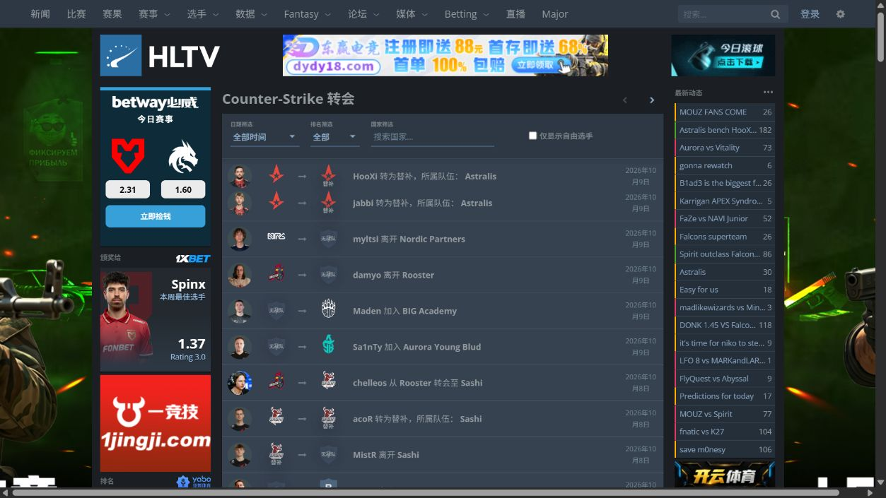
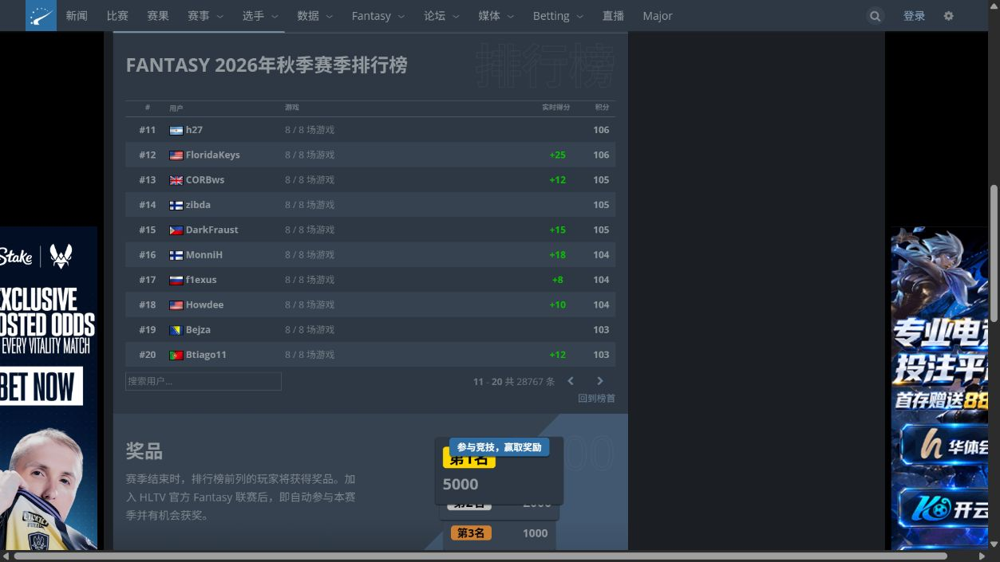

# 阶段 D：0.1.14 独立转会与 Fantasy 总览

日期：2026-10-10（北京时间）。基线：冻结的 0.1.13。I10 与 I11 本版选定范围的实现、本地检查和实页临时运行完成；持久安装留待阶段 E，阶段 C 的 Stats 实页缺口仍保留。

## 本版范围与取舍

- I10：`/transfers` 独立列表及原站查询参数形成的筛选/分页页；不把战队资料中的转会表当作独立列表，不虚构没有采样证据的独立详情路由。
- I11：选择正常可访问的 `/fantasy` 总览，包括月份/游戏、三类排行榜、搜索/分页、积分与奖励说明；新增独立“Fantasy 总览”开关。联赛、阵容编辑、用户账号和规则正文子路由保持 `other`，没有代用户提交或保存。
- VRS 预测 `/valve-ranking/teams/event/8295` 可正常读取，包含 1500 次模拟、即将进行的比赛数与 What if 控件。本版按方案“VRS 或 Fantasy”的取舍选择 Fantasy，总览之外的预测参数/模拟输出与算法另轮处理；没有把可读取页面描述为访问失败。
- 两个新模块默认开启，配置 schema 2、存储键、已有开关、地图偏好和权限保持。关闭某个新模块不影响公共导航和其他页面模块；菜单仍按现有机制保存后刷新。

## 实页样本

| 页面/状态 | 本次来源与操作 | 证据边界 |
|---|---|---|
| [独立转会列表](https://www.hltv.org/transfers) | Chrome/独立内置浏览器正常访问；筛选、加入/离队/替补/转会/回归主力/教练语句、日期、状态、图标 | 选手与队伍的 `a > b` 和独立 Text 保留；正文介绍不纳入固定 UI 翻译 |
| 排名/日期/自由选手 | 原控件依次选择 Top 5、自由选手、Last month | 原站 URL 包含 `startDate=2026-09-10&endDate=2026-10-10&ranking=Top5&freeAgentsOnly=true`；只读筛选导航 |
| [国家空结果](https://www.hltv.org/transfers?country=Ethiopia) | 在原国家输入框键入测试国家，等待原自动补全，再点 Ethiopia | `.transfers-grouped` 实际为空，保持空结构，不自创“暂无转会”提示；国家实体/查询参数保持 |
| [转会下一页](https://www.hltv.org/transfers?page=1) | 点击原 `.transfer-pagination-top .pagination-next` | 新数据中的 `Ex3rcice 从 3DMAX 转会至 OG` 等动态语句继续翻译，原链接可导航 |
| [Fantasy 总览](https://www.hltv.org/fantasy) | 正常总览：2026 秋季、合作方游戏、月份、赛季榜、积分/奖励说明 | 赛事正式名称、用户名、奖励数值不翻译；不参加游戏或修改阵容 |
| Fantasy 月份展开 | 点 Show earlier months，再点此前月份卡片 | 原站加载此前游戏，固定状态/数量继续翻译；不接管展开逻辑 |
| 名人/自定义榜 | 依次点原 `.season-standing-tabs .tab` | DOM 替换后标题/表头继续翻译；Chrome 的创建入口只读，未登录内置浏览器显示“登录后即可使用自定义排行榜” |
| Fantasy 搜索空结果 | 输入合成查询 `zzzzhltvzhcnvalidation`，随后清空 | 输入不改写，原 `.autocomplete-items` 空结构保持；未发送私人资料 |
| [Fantasy 下一页](https://www.hltv.org/fantasy?offset=10) | 点击原下一页链接 | 排名从 #11 开始，显示 `11 - 20 共 28767 条`；新增 To Top 精确译为“回到榜首”，目标仍为 `offset=0` |
| [VRS 预测](https://www.hltv.org/valve-ranking/teams/event/8295) | 从赛事 VRS 机会区域的真实链接进入 | 只读确认入口及当前结构；没有运行 What if 模拟，未纳入发布范围 |

独立内置浏览器没有已安装的汉化脚本，以构建产物临时运行并模拟 GM API。正常导航会卸载临时脚本；转会筛选页重新临时加载，不能将它记作用户管理器的持久安装。

## 实现与保护

`src/adapters/transfers.ts` 只匹配 `.transfer` 固定槽位，完整独立 Text 使用“从 … 转会至 …”“加入”“离开”“转为替补，所属队伍”“回归主力阵容，所属队伍”“担任教练”。不重排链接或追加后缀，不写生产容器的 innerHTML。日期通过已有 `dateText` 翻译显示字符串，不读取时间戳重算时区。

转会 BENCH/COACH 位于战队链接中的 `.transfer-team-status`。保护规则仅放行这个直属状态槽位，外层若在新闻/论坛内容区仍保护；队伍/选手 `a > b`、徽标 title/alt 和链接不放行。独立无战队图标的 alt/title 是固定 UI，可翻译。

`src/adapters/fantasy.ts` 覆盖总览固定文案与完整数量/赛季模板；排行榜的用户名、赛事卡片 `.game-name`、获胜用户 `.winners`、搜索候选区受保护，防止与 Ancient/Train 等地图同名时误翻。积分说明保留 span/a、月份计数保留每个状态数量，跨节点分页只翻译 `of 数字` 这个 Text，不覆盖 strong、箭头或链接。奖励不补原站没有显示的币种。

夹具来自本次正常 DOM 的脱敏最小结构：`transfers.html`、`transfers-empty.html`、`fantasy.html`、`fantasy-celebrity.html`、`fantasy-custom.html`、`fantasy-custom-guest.html`。去除广告、账号信息和资源外链；用户名/实体使用测试名称。月份/榜单只保留必要代表记录；序列化后 HTML 解析会规范化原站 tbody 内的 a/tr 嵌套，不把夹具中的导航和合成监听器视为原站运行脚本。未登录自定义榜采样时已临时汉化，其已知标题/说明按先前原文样本还原，登录提示取实际英文。

## 检查结果

- `npm run check` 全部通过：15 个文件、79 项单元/DOM，TypeScript、0.1.14 构建、84 项双视口 Chromium（1440×900、390×844）。[完整日志](../artifacts/qa/check-0.1.14.log)。
- 新增七项单元/DOM 与八项双视口回归：路由/配置兼容、实体保护、跨节点/监听器保持、筛选隐式 value/data-link、动态数据与未知句式、空状态、原文恢复及独立菜单。原有核心/比赛/Stats/排名测试仍通过。
- 冻结 0.1.13 对新增两个桌面用例复现预期失败：转会标题仍英文、Fantasy 赛季标题仍英文；[基线失败日志](../artifacts/qa/stage-d-0.1.13-failures.log)。没有将失败的基线作为交付版本。
- 实页初次翻译前后，转会选项 value/data-link、选手/队伍文本、全部目标链接及日期 data-unix 相等；Fantasy 的数字、赛事/用户名称及目标链接相等。实页交互单独记录在 [验证 JSON](../artifacts/qa/stage-d-live-0.1.14.json)。
- 完整检查发现当前 `event-detail.ts` 的赛制说明已用“季军赛”，原断言仍期待“季军决胜赛”；保留当前实现并同步两个断言，没有改写该业务译法。
- 版本/元数据/最终产物哈希见 [清单](../artifacts/qa/0.1.14-manifest.json)。[0.1.13 回退文件](../artifacts/releases/0.1.13/README.md)在源码修改前冻结。

本轮没有新增索引或改动调度/限流核心，也未重跑阶段 B/C 全套性能基准，不宣称 0.1.14 更快。新增模块规则只在对应路由激活；全站新增的是 Fantasy 实体保护。完整原有回归用于确认功能未退化，不能替代性能测量。

## 预览与后续边界

阶段 D 本版选定范围完成。后续仍包括未取得的转会特殊句式/详情、完整 VRS 模拟器、Fantasy 联赛/阵容/账号子页，以及阶段 C 未完成的 Stats 实页门槛；未知完整句式保留原文。真实 Tampermonkey 安装、升级、刷新/重开、配置持久化、回退与更新渠道仍属于阶段 E。

使用新版时，将 `dist/hltv-zh-cn.user.js` 完整覆盖油猴中原“HLTV 简体中文”，保存并刷新；保持只启用一份汉化脚本。无需新建第二份脚本。
